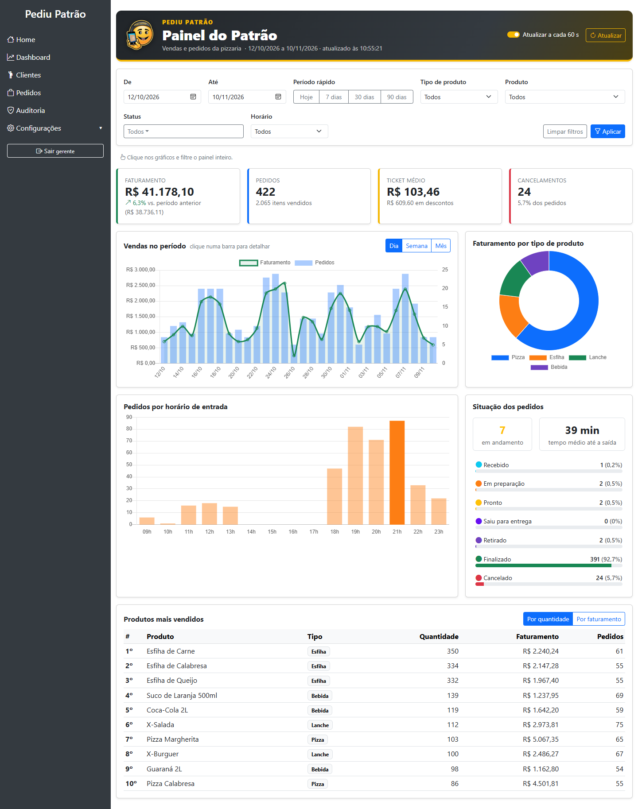

# Sistema PediuPatrão  — Controle de acesso, pedidos e auditoria

Sistema de pedidos da pizzaria (Java 21, Spring Boot 3.4, Spring Security, MongoDB, Thymeleaf), evoluído para a Atividade Prática M1.

- **Parte 1:** perfis de acesso, regras de pedidos, descontos, cancelamentos e auditoria (seções abaixo).
- **Parte 2:** dashboard administrativo com API própria. Documentação completa (requisitos funcionais e não funcionais, decisões de projeto, endpoints e evidências de testes) em [docs/documentacao-dashboard.md](docs/documentacao-dashboard.md).
- **Vídeo de demonstração da Parte 2:** [baixar/assistir (MP4, 95,8 MB)](https://github.com/alanavb/Sistema-de-Pedidos---PediuPatrao/releases/download/v2.0/VideoDemonstrativoParte2_AlanaBarbosa.mp4) · [release v2.0](https://github.com/alanavb/Sistema-de-Pedidos---PediuPatrao/releases/tag/v2.0)



## Como executar

Requisitos: JDK 21, Maven (ou `mvnw`) e um MongoDB. Por padrão a aplicação usa `mongodb://127.0.0.1:27017/pizzaria`; para outro banco (ex.: Atlas) defina a variável de ambiente `MONGODB_URI`.

```bash
./mvnw spring-boot:run     # sobe em http://localhost:8080
./mvnw test                # testes automatizados
```

### Dados de demonstração (dashboard)

Para o dashboard ter o que mostrar, suba com o perfil `demo`:

```bash
./mvnw spring-boot:run "-Dspring-boot.run.profiles=demo"
```

Se o banco ainda não tiver nenhum pedido, são criados 14 produtos, 12 clientes (só quando não existem) e cerca de 1.500 pedidos dos últimos 120 dias, com mais movimento no jantar e nos fins de semana, alguns descontos e cancelamentos, e pedidos da última hora ainda em andamento. Com pedidos já cadastrados a carga não roda, para não misturar dados fictícios com reais. Os registros são gravados direto no banco e por isso não aparecem na auditoria. O número de dias pode ser alterado com `-Ddemo.dias=60`.

### MongoDB local em replica set

Cada operação e o seu registro de auditoria são gravados na mesma transação, e o MongoDB só aceita transações em replica set. O Atlas já funciona assim; no MongoDB local é preciso ativar um replica set de um nó:

1. No `mongod.cfg`, troque `#replication:` por:
   ```yaml
   replication:
     replSetName: rs0
   ```
2. Reinicie o serviço `MongoDB`.
3. No `mongosh`, rode uma única vez: `rs.initiate({_id: "rs0", members: [{_id: 0, host: "127.0.0.1:27017"}]})`

Os testes de `TransacaoAuditoriaTest` simulam falha na gravação da auditoria e conferem que a operação foi desfeita; sem replica set eles são ignorados.

Na primeira execução são criados (se não existirem) três usuários de demonstração. 

| Usuário | Senha | Perfil |
|---|---|---|
| admin | teste123 | ADMIN |
| gerente | gerente123 | GERENTE |
| atendente | atendente123 | ATENDENTE |

## Requisitos implementados

### RF01 — Perfis e autorização
- Perfis `ADMIN`, `GERENTE`, `ATENDENTE` (`entity/Perfil`), gravados em `Usuario.role` e carregados como `ROLE_*` em `UsuarioDetailsService` (antes todos eram `USER`).
- Autorização no backend em `SecurityConfig` (regras por URL/método HTTP, `anyRequest` exige um dos três perfis) e `@PreAuthorize("hasRole('GERENTE')")` nos serviços de desconto e cancelamento (defesa em profundidade). Esconder botões (`sec:authorize`) é só conveniência visual.
- Acesso negado devolve 403 e fica no log (`Acesso negado: usuario=... uri=...`).
- CSRF reativado: formulários Thymeleaf recebem o token automaticamente e o `layout.html` injeta o cabeçalho em todas as chamadas `fetch` não-GET.
- Usuários: `/usuarios/**` e `/api/usuarios/**` só para ADMIN (a rota `/api/usuarios` antes era pública). O perfil é validado contra o enum, ninguém altera o **próprio** perfil nem exclui a si mesmo (impede autoelevação), username é único e a senha nunca é devolvida pela API (`@JsonProperty(WRITE_ONLY)`).

| Operação | ADMIN | GERENTE | ATENDENTE |
|---|:---:|:---:|:---:|
| Gerenciar usuários/perfis | ✔ | | |
| Consultar pedidos | ✔ | ✔ | ✔ |
| Registrar pedido | | ✔ | ✔ |
| Avançar status do pedido | | ✔ | |
| Desconto / cancelamento | | ✔ | |
| Consultar clientes | | ✔ | ✔ |
| Cadastrar/atualizar clientes | | | ✔ |
| Excluir cliente | | ✔ | |
| Consultar auditoria | ✔ | ✔ | |
| Dashboard administrativo | ✔ | ✔ | |

Decisões onde o enunciado era omisso: avançar o status foi atribuído ao GERENTE ("gerenciar pedidos"); a exclusão de clientes (já existente) ficou com o GERENTE e é auditada; produtos: leitura para todos, escrita para ADMIN e GERENTE.

### RF02 — Pedido
`Pedido` guarda itens (`ItemPedido`: produto, quantidade, preço unitário, subtotal), subtotal, desconto %, valor total, responsável e data/hora de entrada. A API recebe apenas `clienteId` e `{produtoId, quantidade}` (`PedidoRequest`); preços vêm do cadastro de produtos e o total é calculado em `PedidoService` (BigDecimal, 2 casas). Valida cliente, produto ativo e quantidade > 0.

### RF03 — Fluxo de status
`RECEBIDO → EM_PREPARACAO → PRONTO → SAIU_PARA_ENTREGA | RETIRADO → FINALIZADO`, definido em `StatusPedido.proximos()`. Transições inválidas retornam 409; a saída grava data/hora e responsável; `CANCELADO` não pode ser usado em `PUT /status` e nenhum pedido cancelado muda de estado.

### RF04 — Cancelamento e desconto (somente GERENTE)
- `POST /api/pedidos/{id}/cancelamento?justificativa=...`: justificativa obrigatória, só antes da saída; preserva os dados e grava quem/quando/por quê.
- `POST /api/pedidos/{id}/desconto?percentual=...`: >0 e ≤20%, só antes da saída; recalcula o total no servidor (o novo desconto substitui o anterior).

### RF05 — Auditoria
- Coleção `auditoria` (`AuditoriaEvento`): usuário, perfil, data/hora, operação, entidade + id, lista de `{campo, valorAnterior, valorNovo}` e justificativa.
- Gerada em `AuditoriaService.registrar` a partir do diff entre estado anterior e posterior. Auditados: criação de pedido, mudança de status, desconto, cancelamento, criação/alteração/exclusão de cliente (inclui logradouro, telefone etc.) e criação/alteração/exclusão de usuário (só username e perfil — **senhas nunca entram na auditoria**).
- Consulta em `/auditoria` e `GET /api/auditoria` (ADMIN e GERENTE). `AuditoriaRepository` estende apenas `Repository` (sem update/delete) e não existe endpoint de escrita; outros métodos HTTP em `/api/auditoria` são negados.
- Dados pessoais do cliente são gravados mascarados (`MascaraDados`): telefone `(**) *****-4321`, nome `Maria A. S.`, CEP `08780-***`, número e complemento ocultos. A comparação usa os valores reais, então uma troca de telefone continua gerando registro.
- A operação e o seu registro de auditoria são gravados na mesma transação do MongoDB: se a auditoria falhar, a operação é desfeita.
- Não é possível excluir nem rebaixar o último administrador do sistema.

## Parte 2 — Dashboard administrativo

Menu **Dashboard** (ADMIN e GERENTE). Indicadores de vendas com comparação ao período anterior, gráficos de vendas no tempo, por tipo de produto e por horário, situação dos pedidos, ranking de produtos e filtros por período, status, tipo, produto e horário. Clicar em um gráfico, numa linha de status ou no ranking filtra o painel inteiro.

| Endpoint (`GET`) | Conteúdo |
|---|---|
| `/api/dashboard/resumo` | Indicadores gerais |
| `/api/dashboard/vendas?agrupamento=DIA\|SEMANA\|MES` | Vendas no tempo |
| `/api/dashboard/vendas-por-hora` | Pedidos por horário de entrada |
| `/api/dashboard/vendas-por-tipo` | Faturamento por tipo de produto |
| `/api/dashboard/situacao-pedidos` | Pedidos por status e tempo médio até a saída |
| `/api/dashboard/produtos-mais-vendidos?limite=10&criterio=QUANTIDADE\|FATURAMENTO` | Ranking de produtos |
| `/api/dashboard/filtros` | Opções para montar os filtros |

Parâmetros, exemplos de requisição e resposta e erros de cada endpoint: [docs/documentacao-dashboard.md](docs/documentacao-dashboard.md#7-documentação-da-api). Relatório dos testes: [docs/evidencias/relatorio-testes.md](docs/evidencias/relatorio-testes.md).

## Principais arquivos alterados/criados
`config/SecurityConfig`, `config/DataInitializer`, `service/{PedidoService,ClienteService,UsuarioService,UsuarioDetailsService,AuditoriaService}`, `entity/{Pedido,ItemPedido,StatusPedido,Perfil,AuditoriaEvento,Alteracao}`, `controller/{PedidoController,AuditoriaController,ApiExceptionHandler,UsuarioController,HomeController}`, templates `layout`, `pedidos`, `auditoria`, `usuarios/*`, `fragments/sidebar`, e o teste `PedidoServiceTest`.

Parte 2: `controller/DashboardController`, `service/DashboardService`, `dto/dashboard/*`, `config/{DadosDemonstracao,GeradorPedidosDemonstracao,MongoInitConfig}`, template `dashboard`, e os testes em `src/test` (`Dashboard*Test`, `FiltroDashboardTest`, `GeradorPedidosDemonstracaoTest`).
