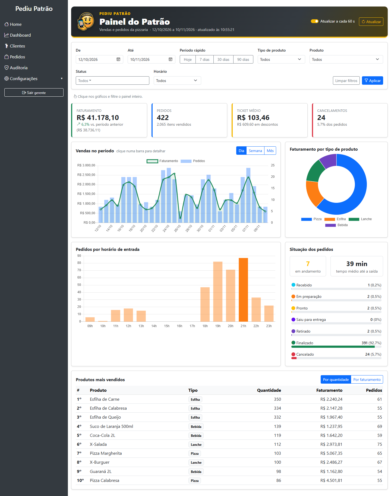
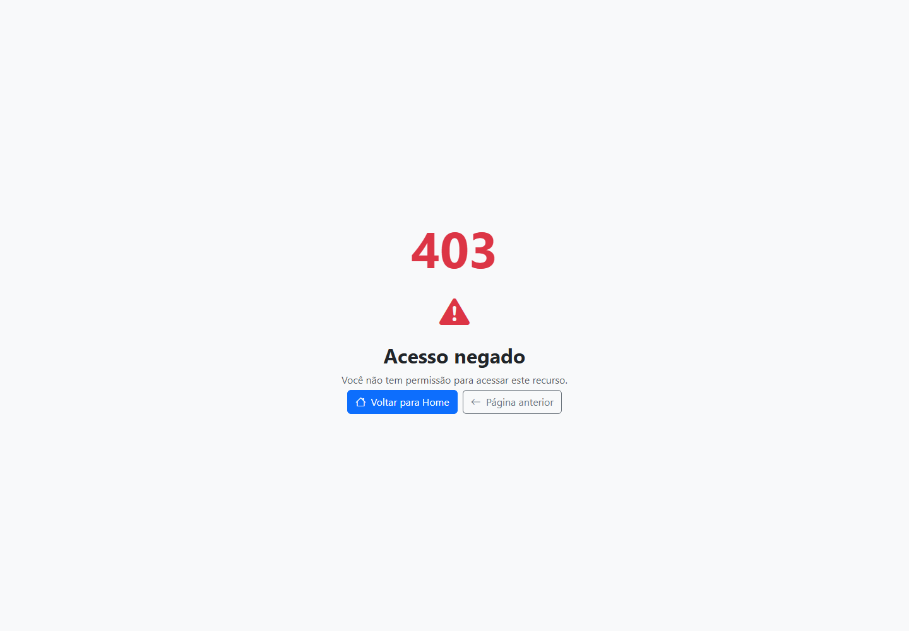
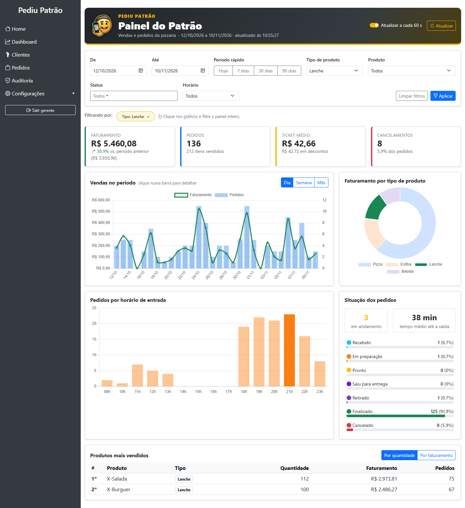
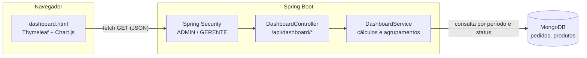
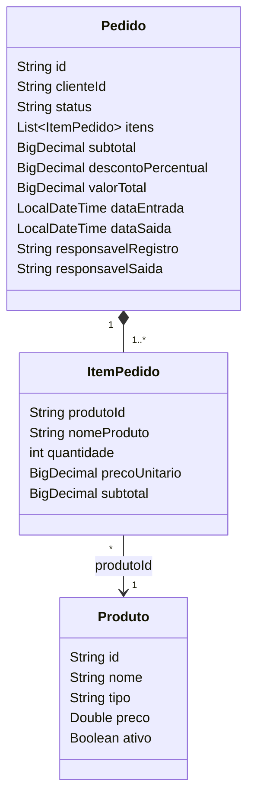
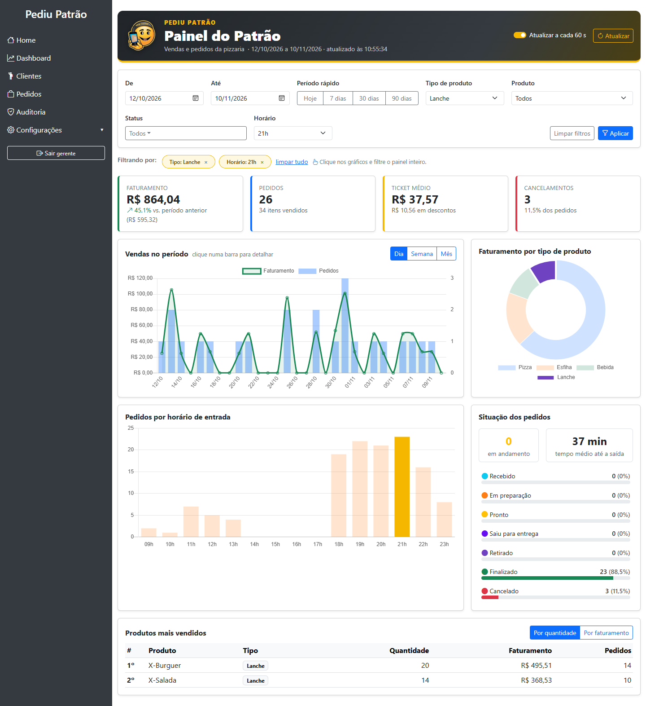
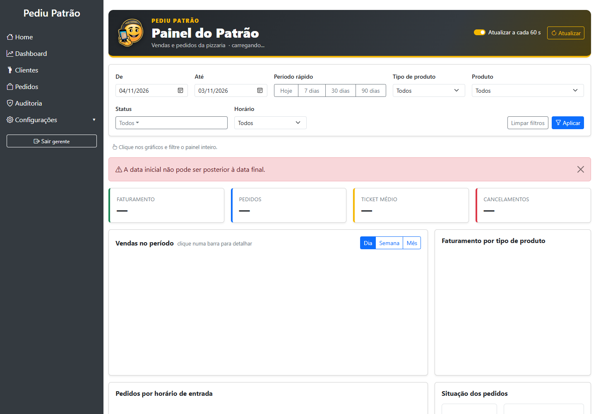

# Dashboard Administrativo — PediuPatrão

Atividade Prática M1 — Parte 2. Documento de requisitos, projeto, API e evidências de testes do dashboard administrativo integrado ao sistema de pedidos.

## Sumário

1. [Contexto e objetivo](#1-contexto-e-objetivo)
2. [Atores e acesso](#2-atores-e-acesso)
3. [Requisitos funcionais](#3-requisitos-funcionais)
4. [Requisitos não funcionais](#4-requisitos-não-funcionais)
5. [Decisões de análise e projeto](#5-decisões-de-análise-e-projeto)
6. [Modelo de dados utilizado](#6-modelo-de-dados-utilizado)
7. [Documentação da API](#7-documentação-da-api)
8. [Evidências de testes](#8-evidências-de-testes)
9. [Como executar](#9-como-executar)
10. [Organização das branches (gitflow)](#10-organização-das-branches-gitflow)

---

## 1. Contexto e objetivo

A pizzaria já usava o PediuPatrão para cadastrar clientes, produtos e pedidos, com controle de perfis, fluxo de status e auditoria (Parte 1). Faltava uma visão gerencial: quanto se vendeu, o que mais sai, em que horário o movimento é maior e como os pedidos estão andando.

O dashboard reúne essas informações numa tela única, alimentada por uma API própria (`/api/dashboard/*`) que consulta os pedidos gravados no MongoDB. O responsável pelo estabelecimento consegue acompanhar o desempenho, comparar com o período anterior e filtrar a análise por período, status, tipo de produto, produto e horário.



## 2. Atores e acesso

| Perfil | Acesso ao dashboard | Motivo |
|---|---|---|
| GERENTE | Consulta | Responsável pela operação e pelas decisões de venda |
| ADMIN | Consulta | Administra o sistema e também acompanha os resultados |
| ATENDENTE | Bloqueado (403) | Registra pedidos; não precisa de dados financeiros consolidados |

A restrição é aplicada no backend (Spring Security), tanto na página `/dashboard` quanto nos endpoints `/api/dashboard/**`. O item "Dashboard" do menu só aparece para ADMIN e GERENTE, mas esconder o item não é o que protege: acessar a URL diretamente com o perfil ATENDENTE retorna 403.



## 3. Requisitos funcionais

| ID | Requisito | Descrição | Onde foi atendido |
|---|---|---|---|
| RF01 | Indicadores gerais de vendas | Exibir faturamento, total de pedidos, ticket médio, itens vendidos, descontos concedidos, cancelamentos (quantidade e taxa), pedidos em andamento e variação do faturamento em relação ao período anterior de mesma duração | `GET /api/dashboard/resumo`; cards no topo da tela |
| RF02 | Análise de vendas (gráficos) | Mostrar a evolução das vendas no tempo (por dia, semana ou mês), a distribuição do faturamento por tipo de produto e a quantidade de pedidos por horário de entrada, destacando o horário de pico | `GET /api/dashboard/vendas`, `/vendas-por-tipo`, `/vendas-por-hora`; gráficos de linha/barras, rosca e barras |
| RF03 | Situação dos pedidos | Quantidade e percentual de pedidos em cada status do fluxo, total em andamento e tempo médio entre a entrada e a saída | `GET /api/dashboard/situacao-pedidos`; painel "Situação dos pedidos" |
| RF04 | Produtos mais vendidos | Ranking configurável (1 a 50 itens) ordenado por quantidade ou por faturamento, com tipo e número de pedidos em que o produto aparece | `GET /api/dashboard/produtos-mais-vendidos`; tabela de ranking |
| RF05 | Filtros de consulta | Filtrar por período (com atalhos de 1, 7, 30 e 90 dias), status (vários), tipo de produto, produto e horário. Os mesmos filtros valem para todos os componentes. Clicar em um gráfico, numa linha de status ou no ranking aplica o filtro correspondente ao painel inteiro (filtro cruzado) | Parâmetros comuns da API; formulário de filtros, chips de filtros ativos e cliques nos gráficos |
| RF06 | Integração com a API | A tela não acessa o banco: todo dado vem dos endpoints REST, chamados em paralelo via `fetch`. As opções de filtro (status, tipos, produtos, período com pedidos) também vêm da API | `GET /api/dashboard/filtros` e demais endpoints; script da página `dashboard.html` |
| RF07 | Atualização e tratamento de dados | Atualização automática a cada 60 s (pode ser desligada) e manual. Pedidos cancelados ficam fora do faturamento; pedidos antigos sem itens/valores são ignorados e informados; períodos sem venda aparecem com zero; valores monetários com duas casas; mensagens claras para erro de validação, sessão expirada e servidor fora do ar | `DashboardService`, `FiltroDashboard`, `ApiExceptionHandler`; avisos na tela |

### Critérios de aceite principais

- Faturamento = soma de `valorTotal` dos pedidos não cancelados do período. Com filtro de tipo ou produto, soma apenas os itens filtrados, já com o desconto do pedido aplicado ao item.
- Ticket médio = faturamento ÷ pedidos não cancelados (zero quando não há pedidos).
- Taxa de cancelamento = cancelados ÷ total de pedidos do período × 100.
- Variação = (faturamento atual − anterior) ÷ anterior × 100; nula quando o período anterior não teve vendas.
- O período inclui o dia final inteiro (até 23:59:59).
- Sem datas informadas, considera os últimos 30 dias até hoje; o período máximo é de 366 dias.
- A série no tempo traz todos os dias/semanas/meses do intervalo, inclusive os sem venda.
- Filtro cruzado: o componente clicado continua mostrando todas as opções, com a escolhida destacada; clicar de novo remove o filtro.



## 4. Requisitos não funcionais

| ID | Categoria | Requisito | Como foi atendido |
|---|---|---|---|
| RNF01 | Segurança | Somente ADMIN e GERENTE acessam o dashboard; a verificação é feita no servidor | Regras em `SecurityConfig` para `/dashboard` e `/api/dashboard/**`; 403 em JSON para a API e página de erro para a tela |
| RNF02 | Segurança | O dashboard é somente leitura | Apenas `GET` é aceito; `POST`, `PUT` e `DELETE` em `/api/dashboard/**` são negados (`denyAll`) |
| RNF03 | Segurança | Proteção contra CSRF e saída segura de dados | CSRF ativo (mensagem própria quando o token falta); textos vindos da API são escapados antes de entrar no HTML |
| RNF04 | Desempenho | Consultas restritas ao período no banco | Filtro de período e status aplicado no MongoDB com índice `idx_pedidos_dataEntrada`; período máximo de 366 dias |
| RNF05 | Desempenho | A tela não deve esperar uma chamada para fazer a próxima | As seis consultas são feitas em paralelo (`Promise.all`); a atualização automática pausa com a aba oculta |
| RNF06 | Precisão | Valores monetários sem erro de arredondamento | `BigDecimal` com duas casas e `RoundingMode.HALF_UP`, as mesmas regras do `PedidoService` |
| RNF07 | Usabilidade | Interface em português, com formatação brasileira | Moeda em R$, datas dd/mm/aaaa, números com separador de milhar; filtros ficam na URL para recarregar ou compartilhar a mesma visão |
| RNF08 | Usabilidade | Layout utilizável em telas menores | Grade Bootstrap responsiva; filtros reorganizados abaixo de 1200 px |
| RNF09 | Manutenibilidade | Seguir a arquitetura em camadas existente | `DashboardController` → `DashboardService` → MongoDB; DTOs como `record`; nenhuma dependência nova de produção (Chart.js 2.9.4 já estava no projeto) |
| RNF10 | Testabilidade | Regras de cálculo verificáveis sem banco e integração verificável com banco | Testes unitários com cenário calculado à mão e testes de integração no MongoDB local |

## 5. Decisões de análise e projeto

### Arquitetura



### Justificativas

1. **Um endpoint por informação, e não um único endpoint com tudo.** Cada componente da tela (cards, gráficos, ranking) tem seu endpoint. Isso deixa cada resposta pequena e com significado claro, permite testar cada cálculo isoladamente e é o que torna possível o filtro cruzado: o gráfico de tipos é consultado sem o filtro de tipo, o de horários sem o filtro de hora, e assim por diante, para que o componente clicado continue mostrando todas as opções com a escolhida destacada.

2. **Filtro no banco, cálculo no serviço.** O MongoDB recebe a consulta já restrita ao período (e aos status, quando informados), usando o índice em `dataEntrada`. Os agrupamentos e somas são feitos em Java. Para o volume de uma pizzaria (algumas centenas de pedidos por mês) isso é rápido, e mantém em um só lugar regras que seriam complexas num pipeline de agregação: rateio do desconto entre os itens, exclusão de pedidos incompletos, preenchimento de dias sem venda e comparação com o período anterior. As regras também ficam testáveis sem banco. Se o volume crescer muito, o mesmo serviço pode trocar a consulta por um *aggregation pipeline* sem mudar a API.

3. **Comparação com o período anterior.** O enunciado pede para identificar tendências. Comparar com o período imediatamente anterior, de mesmo tamanho, responde à pergunta "estamos vendendo mais ou menos?" sem que o usuário precise montar duas consultas.

4. **Cancelados fora do faturamento, mas dentro da contagem.** Um pedido cancelado não gerou receita, mas é um dado operacional importante. Por isso entra no total de pedidos, na taxa de cancelamento e na situação dos pedidos, e fica fora de faturamento, ticket médio, ranking e gráficos de venda.

5. **Desconto rateado por item.** O desconto é aplicado ao pedido inteiro. Para que o faturamento por tipo e o ranking de produtos somem o mesmo que o faturamento total, o percentual de desconto do pedido é aplicado também ao subtotal de cada item.

6. **Pedidos antigos sem itens.** Pedidos criados antes da evolução do cadastro (Parte 1) não têm itens nem valores. Em vez de quebrar os cálculos ou contá-los como zero, eles são ignorados e informados no campo `registrosDesconsiderados` e num aviso na tela.

7. **Dashboard somente leitura e restrito por perfil.** Nenhuma operação do dashboard altera dados, então apenas `GET` é aceito. O acesso segue a divisão de responsabilidades definida na Parte 1.

8. **Dados de demonstração em perfil separado.** Para que os gráficos tenham conteúdo, o perfil `demo` gera cerca de 1.500 pedidos dos últimos 120 dias, com padrões realistas (pico no jantar, mais movimento no fim de semana, crescimento ao longo do período). A carga só roda com o perfil ativo e com o banco sem pedidos, para não misturar dados fictícios e reais.

9. **Datas no fuso local.** As datas são gravadas como `LocalDateTime` e o agrupamento por dia e hora usa o horário local, que é o que o gerente espera ver. No navegador, as datas dos filtros são montadas com os componentes locais da data (e não com `toISOString`, que converte para UTC e poderia mudar o dia).

## 6. Modelo de dados utilizado

O dashboard não criou coleções novas: ele lê as coleções `pedidos` e `produtos` já existentes.



| Campo | Uso no dashboard |
|---|---|
| `Pedido.dataEntrada` | Filtro de período (indexado), série no tempo, horário |
| `Pedido.status` | Filtro de status, situação dos pedidos, exclusão de cancelados |
| `Pedido.valorTotal`, `subtotal`, `descontoPercentual` | Faturamento, ticket médio, descontos concedidos |
| `Pedido.dataSaida` | Tempo médio entre entrada e saída |
| `ItemPedido.*` | Itens vendidos, ranking, faturamento por tipo e produto |
| `Produto.tipo` | Agrupamento e filtro por tipo de produto |

Índice criado na inicialização (`MongoInitConfig`): `pedidos.dataEntrada` ascendente (`idx_pedidos_dataEntrada`).

## 7. Documentação da API

### 7.1 Informações gerais

| Item | Valor |
|---|---|
| URL base | `http://localhost:8080/api/dashboard` |
| Formato | JSON (UTF-8) |
| Métodos aceitos | Somente `GET` |
| Autenticação | Sessão do Spring Security (cookie `JSESSIONID` obtido no login em `/login`) |
| Perfis autorizados | ADMIN e GERENTE |

Para chamar a API fora do navegador é preciso primeiro fazer o login. Exemplo com `curl` (bash):

```bash
# 1. abre a tela de login e guarda o token CSRF do formulário
TOKEN=$(curl -s -c cookies.txt http://localhost:8080/login | grep -o 'name="_csrf" value="[^"]*"' | sed 's/.*value="//;s/"//')
# 2. faz o login como gerente
curl -s -b cookies.txt -c cookies.txt -d "username=gerente&password=gerente123&_csrf=$TOKEN" http://localhost:8080/login
# 3. consulta a API com a sessão
curl -s -b cookies.txt "http://localhost:8080/api/dashboard/resumo?dataInicio=2026-11-04&dataFim=2026-11-10"
```

No navegador, basta estar logado e abrir a URL.

### 7.2 Parâmetros comuns (filtros)

Aceitos por todos os endpoints, exceto `/filtros`. Todos são opcionais.

| Parâmetro | Tipo | Exemplo | Regra |
|---|---|---|---|
| `dataInicio` | data `yyyy-MM-dd` | `2026-11-04` | Padrão: `dataFim` − 29 dias |
| `dataFim` | data `yyyy-MM-dd` | `2026-11-10` | Padrão: hoje. Inclui o dia inteiro |
| `status` | lista separada por vírgula | `FINALIZADO,CANCELADO` | Valores: `RECEBIDO`, `EM_PREPARACAO`, `PRONTO`, `SAIU_PARA_ENTREGA`, `RETIRADO`, `FINALIZADO`, `CANCELADO` |
| `tipoProduto` | texto | `Pizza` | Deve existir no cadastro de produtos (maiúsculas/minúsculas não importam) |
| `produtoId` | texto | `6af3177e1f89a15aadf00b4e` | Considera apenas os itens desse produto |
| `hora` | inteiro 0–23 | `21` | Considera apenas pedidos que entraram nessa hora |

Regras do período: `dataInicio` não pode ser posterior a `dataFim`, e o intervalo tem no máximo 366 dias.

### 7.3 Respostas de erro

Todos os erros da API têm o formato:

```json
{ "erro": "mensagem explicando o problema" }
```

| HTTP | Quando acontece | Exemplo real de resposta |
|---|---|---|
| 400 | Data em formato inválido (`?dataInicio=31/12/2026`) | `{"erro":"Valor inválido para o parâmetro 'dataInicio': 31/12/2026"}` |
| 400 | Data inicial depois da final | `{"erro":"A data inicial não pode ser posterior à data final."}` |
| 400 | Período maior que 366 dias | `{"erro":"O período consultado pode ter no máximo 366 dias."}` |
| 400 | Status inexistente (`?status=ENTREGUE`) | `{"erro":"Valor inválido para o parâmetro 'status': ENTREGUE"}` |
| 400 | Tipo de produto inexistente (`?tipoProduto=Sushi`) | `{"erro":"Tipo de produto inexistente: Sushi"}` |
| 400 | Hora fora de 0–23 (`?hora=24`) | `{"erro":"A hora deve estar entre 0 e 23."}` |
| 400 | Agrupamento inválido (`?agrupamento=ANO`) | `{"erro":"Valor inválido para o parâmetro 'agrupamento': ANO"}` |
| 400 | Limite fora de 1–50 (`?limite=0`) | `{"erro":"O limite deve estar entre 1 e 50."}` |
| 302 | Sem login | Redireciona para `/login` |
| 403 | Perfil sem permissão (ATENDENTE) | `{"erro":"Acesso negado: seu perfil não tem permissão para esta operação."}` |
| 403 | Método diferente de `GET` sem token CSRF | `{"erro":"Token CSRF ausente ou inválido. Recarregue a página e tente novamente."}` |
| 403 | Método diferente de `GET` com token CSRF válido | `{"erro":"Acesso negado: seu perfil não tem permissão para esta operação."}` |

> Os exemplos desta seção foram obtidos da aplicação rodando com os dados de demonstração (perfil `demo`). Os identificadores de produto mudam a cada carga.

### 7.4 `GET /api/dashboard/resumo` — indicadores gerais (RF01)

Parâmetros: apenas os comuns.

Requisição:

```
GET /api/dashboard/resumo?dataInicio=2026-11-04&dataFim=2026-11-10
```

Resposta `200`:

```json
{
  "dataInicio": "2026-11-04",
  "dataFim": "2026-11-10",
  "faturamento": 9279.27,
  "faturamentoPeriodoAnterior": 9694.77,
  "variacaoFaturamento": -4.3,
  "totalPedidos": 104,
  "pedidosCancelados": 9,
  "taxaCancelamento": 8.7,
  "ticketMedio": 97.68,
  "itensVendidos": 464,
  "descontosConcedidos": 76.73,
  "pedidosEmAndamento": 7,
  "registrosDesconsiderados": 0,
  "atualizadoEm": "2026-11-10T10:52:41.2676134"
}
```

| Campo | Significado |
|---|---|
| `faturamento` | Soma dos pedidos não cancelados (R$) |
| `faturamentoPeriodoAnterior` | Mesmo cálculo para o período anterior de mesma duração (aqui, 28/10 a 03/11) |
| `variacaoFaturamento` | Variação percentual; `null` se o período anterior não teve vendas |
| `totalPedidos` | Pedidos do período, incluindo cancelados |
| `pedidosCancelados` / `taxaCancelamento` | Quantidade e percentual de cancelados |
| `ticketMedio` | Faturamento ÷ pedidos não cancelados |
| `itensVendidos` | Soma das quantidades dos itens dos pedidos não cancelados |
| `descontosConcedidos` | Diferença entre o valor bruto e o valor cobrado (R$) |
| `pedidosEmAndamento` | Pedidos que não estão finalizados nem cancelados |
| `registrosDesconsiderados` | Pedidos antigos sem itens ou valores, ignorados no cálculo |
| `atualizadoEm` | Momento em que a resposta foi gerada |

Exemplo com filtros: `GET /api/dashboard/resumo?dataInicio=2026-11-04&dataFim=2026-11-10&tipoProduto=Pizza&status=FINALIZADO,CANCELADO` retorna `faturamento` 5374.32, `totalPedidos` 62 e `pedidosCancelados` 7, considerando só os itens de pizza.

Erros possíveis: todos os de parâmetros comuns (seção 7.3).

### 7.5 `GET /api/dashboard/vendas` — vendas no tempo (RF02)

| Parâmetro | Tipo | Padrão | Valores |
|---|---|---|---|
| `agrupamento` | texto | `DIA` | `DIA`, `SEMANA` (a semana é identificada pela segunda-feira em que começa), `MES` |

Requisição:

```
GET /api/dashboard/vendas?dataInicio=2026-11-04&dataFim=2026-11-10&agrupamento=DIA
```

Resposta `200`:

```json
[
  { "periodo": "2026-11-04", "pedidos": 13, "faturamento": 1182.27 },
  { "periodo": "2026-11-05", "pedidos": 8,  "faturamento": 1023.56 },
  { "periodo": "2026-11-06", "pedidos": 20, "faturamento": 1698.94 },
  { "periodo": "2026-11-07", "pedidos": 24, "faturamento": 2387.87 },
  { "periodo": "2026-11-08", "pedidos": 16, "faturamento": 1582.01 },
  { "periodo": "2026-11-09", "pedidos": 7,  "faturamento": 813.52 },
  { "periodo": "2026-11-10", "pedidos": 7,  "faturamento": 591.10 }
]
```

Por mês (`?dataInicio=2026-08-01&dataFim=2026-10-31&agrupamento=MES`):

```json
[
  { "periodo": "2026-08", "pedidos": 333, "faturamento": 32708.51 },
  { "periodo": "2026-09", "pedidos": 359, "faturamento": 39326.88 },
  { "periodo": "2026-10", "pedidos": 424, "faturamento": 43963.67 }
]
```

`pedidos` conta apenas pedidos não cancelados. Períodos sem venda aparecem com `0`.

Erros possíveis: os comuns e `400` para `agrupamento` inválido.

### 7.6 `GET /api/dashboard/vendas-por-hora` — horário de entrada (RF02)

Parâmetros: apenas os comuns. Retorna sempre 24 posições (0 a 23).

Requisição:

```
GET /api/dashboard/vendas-por-hora?dataInicio=2026-11-04&dataFim=2026-11-10
```

Resposta `200` (trecho):

```json
[
  { "hora": 0,  "pedidos": 0,  "faturamento": 0.00 },
  "...",
  { "hora": 18, "pedidos": 10, "faturamento": 847.71 },
  { "hora": 19, "pedidos": 18, "faturamento": 1499.16 },
  { "hora": 20, "pedidos": 15, "faturamento": 1352.10 },
  { "hora": 21, "pedidos": 19, "faturamento": 2107.37 },
  { "hora": 22, "pedidos": 8,  "faturamento": 681.36 },
  { "hora": 23, "pedidos": 7,  "faturamento": 644.77 }
]
```

Erros possíveis: os comuns.

### 7.7 `GET /api/dashboard/vendas-por-tipo` — faturamento por tipo de produto (RF02)

Parâmetros: apenas os comuns. Ordenado do maior para o menor faturamento.

Requisição:

```
GET /api/dashboard/vendas-por-tipo?dataInicio=2026-11-04&dataFim=2026-11-10
```

Resposta `200`:

```json
[
  { "tipo": "Pizza",  "quantidade": 105, "faturamento": 5577.92, "percentual": 60.1 },
  { "tipo": "Esfiha", "quantidade": 219, "faturamento": 1389.53, "percentual": 15.0 },
  { "tipo": "Lanche", "quantidade": 50,  "faturamento": 1275.04, "percentual": 13.7 },
  { "tipo": "Bebida", "quantidade": 90,  "faturamento": 1036.80, "percentual": 11.2 }
]
```

`quantidade` é o número de unidades vendidas; `percentual` é a participação no faturamento. Itens de produtos sem tipo (ou já excluídos do cadastro) aparecem como `"Sem tipo"`.

Erros possíveis: os comuns.

### 7.8 `GET /api/dashboard/situacao-pedidos` — situação dos pedidos (RF03)

Parâmetros: apenas os comuns. Lista todos os status na ordem do fluxo, inclusive os que têm zero pedidos.

Requisição:

```
GET /api/dashboard/situacao-pedidos?dataInicio=2026-11-04&dataFim=2026-11-10
```

Resposta `200`:

```json
{
  "porStatus": [
    { "status": "RECEBIDO",          "quantidade": 1,  "percentual": 1.0 },
    { "status": "EM_PREPARACAO",     "quantidade": 2,  "percentual": 1.9 },
    { "status": "PRONTO",            "quantidade": 2,  "percentual": 1.9 },
    { "status": "SAIU_PARA_ENTREGA", "quantidade": 0,  "percentual": 0.0 },
    { "status": "RETIRADO",          "quantidade": 2,  "percentual": 1.9 },
    { "status": "FINALIZADO",        "quantidade": 88, "percentual": 84.6 },
    { "status": "CANCELADO",         "quantidade": 9,  "percentual": 8.7 }
  ],
  "emAndamento": 7,
  "tempoMedioAteSaidaMinutos": 39
}
```

`tempoMedioAteSaidaMinutos` é a média entre `dataEntrada` e `dataSaida` dos pedidos que já saíram (entrega ou retirada); `null` se nenhum saiu no período.

Erros possíveis: os comuns.

### 7.9 `GET /api/dashboard/produtos-mais-vendidos` — ranking (RF04)

| Parâmetro | Tipo | Padrão | Regra |
|---|---|---|---|
| `limite` | inteiro | `10` | Entre 1 e 50 |
| `criterio` | texto | `QUANTIDADE` | `QUANTIDADE` (desempata pelo faturamento) ou `FATURAMENTO` (desempata pela quantidade) |

Requisição:

```
GET /api/dashboard/produtos-mais-vendidos?dataInicio=2026-11-04&dataFim=2026-11-10&limite=3&criterio=FATURAMENTO
```

Resposta `200`:

```json
[
  { "posicao": 1, "produtoId": "6af3177e1f89a15aadf00b4e", "nome": "Pizza Calabresa",  "tipo": "Pizza", "quantidade": 24, "faturamento": 1261.67, "pedidos": 15 },
  { "posicao": 2, "produtoId": "6af3177e1f89a15aadf00b50", "nome": "Pizza Portuguesa", "tipo": "Pizza", "quantidade": 21, "faturamento": 1183.52, "pedidos": 15 },
  { "posicao": 3, "produtoId": "6af3177e1f89a15aadf00b4f", "nome": "Pizza Margherita", "tipo": "Pizza", "quantidade": 18, "faturamento": 898.20,  "pedidos": 12 }
]
```

`pedidos` é o número de pedidos distintos em que o produto aparece.

Erros possíveis: os comuns, `400` para `limite` fora de 1–50 ou não numérico e `400` para `criterio` inválido.

### 7.10 `GET /api/dashboard/filtros` — opções para os filtros (RF05/RF06)

Sem parâmetros. Usado pela tela para montar os campos de filtro.

Resposta `200` (lista de produtos abreviada):

```json
{
  "status": ["RECEBIDO", "EM_PREPARACAO", "PRONTO", "SAIU_PARA_ENTREGA", "RETIRADO", "FINALIZADO", "CANCELADO"],
  "tiposProduto": ["Bebida", "Esfiha", "Lanche", "Pizza"],
  "produtos": [
    { "id": "6af3177e1f89a15aadf00b59", "nome": "Coca-Cola 2L", "tipo": "Bebida" },
    { "id": "6af3177e1f89a15aadf00b56", "nome": "Esfiha de Calabresa", "tipo": "Esfiha" }
  ],
  "agrupamentos": ["DIA", "SEMANA", "MES"],
  "criteriosRanking": ["QUANTIDADE", "FATURAMENTO"],
  "primeiroPedido": "2026-07-14",
  "ultimoPedido": "2026-11-10",
  "periodoPadraoDias": 30,
  "periodoMaximoDias": 366
}
```

Erros possíveis: `302` sem login e `403` para ATENDENTE.

## 8. Evidências de testes

### 8.1 Testes automatizados

Executados com `./mvnw test`. O relatório completo, com cada caso de teste, está em [evidencias/relatorio-testes.md](evidencias/relatorio-testes.md) (gerado a partir dos relatórios do Surefire pelo script [evidencias/gerar_relatorio.py](evidencias/gerar_relatorio.py)).

**Resultado: 117 testes, 117 passaram, 0 falharam.** Destes, 60 são da Parte 2:

| Classe | Tipo | Testes | O que comprova |
|---|---|---:|---|
| `DashboardServiceTest` | Unitário (Mockito) | 20 | Cálculos de todos os indicadores com um cenário de pedidos calculado à mão (descrito no topo da classe), filtros por tipo, produto e hora, séries com dias sem venda, ranking com desempate e limite, situação dos pedidos e consulta enviada ao banco |
| `DashboardControllerTest` | Web (MockMvc + Spring Security) | 15 | Acesso de ADMIN e GERENTE, bloqueio de ATENDENTE e de quem não está logado, somente leitura, repasse dos filtros e todos os erros 400 |
| `FiltroDashboardTest` | Unitário | 8 | Período padrão, período máximo, data inicial após a final, período anterior, validação da hora |
| `DashboardIntegracaoTest` | Integração (MongoDB real) | 4 | Filtro de período no banco incluindo pedidos exatamente nos limites (00:00 do primeiro dia e 23:59 do último), filtro de status, tipos vindos do cadastro e período disponível |
| `GeradorPedidosDemonstracaoTest` | Unitário | 10 | Coerência da carga de demonstração com as regras de pedido (preços, desconto, datas, status) |
| `AutorizacaoApiTest` (parte) | Web | 3 | Página `/dashboard` e item de menu só para ADMIN e GERENTE |

Rastreabilidade entre requisitos e testes:

| Requisito | Testes |
|---|---|
| RF01 | `resumoIgnoraCanceladosEPedidosIncompletos`, `resumoComparaComOPeriodoAnterior`, `semVendasNoPeriodoAnteriorAVariacaoFicaNula`, `periodoSemPedidosRetornaZeros`, `consideraSoOsPedidosDoPeriodoIncluindoAsBordas` |
| RF02 | `vendasPorDiaPreenchemDiasSemVenda`, `vendasPorSemanaComecamNaSegunda`, `vendasPorMes`, `vendasPorHoraTem24Faixas`, `vendasPorTipoComDescontoAplicadoNosItens` |
| RF03 | `situacaoContaTodosOsStatusETempoMedioDeSaida` |
| RF04 | `rankingPorQuantidadeDesempataPeloFaturamento`, `rankingPorFaturamentoRespeitaOLimite`, `limiteDoRankingEValidado`, `rankingUsaOsTiposCadastrados` |
| RF05 | `filtroPorTipoConsideraSoOsItensDoTipo`, `filtroPorHoraConsideraSoPedidosQueEntraramNaquelaHora`, `filtroPorProdutoConsideraSoOsItensDoProduto`, `filtrosCombinadosDeTipoEHora`, `filtroDeStatusEAplicadoNoBanco`, `filtrosSaoRepassadosAoServico`, testes de `FiltroDashboardTest` |
| RF06 | `DashboardControllerTest` (contrato JSON e parâmetros), `opcoesDeFiltroListamTiposEPeriodoDisponivel`, `opcoesTrazemOPeriodoComPedidos` |
| RF07 | `tipoInexistenteERecusado`, `dataMalFormatadaRetorna400`, `periodoInvertidoRetorna400`, `horaForaDoDiaRetorna400`, `regraDoServicoViraErro400`, `periodoMaximoDe366Dias` |
| RNF01–RNF03 | `atendenteNaoConsultaODashboard`, `semLoginRedirecionaParaOLogin`, `dashboardEsomenteLeitura`, `adminEGerenteAbremODashboard`, `atendenteNaoAbreODashboardNemVeOItemNoMenu`, `requisicaoSemTokenCsrfERecusada` |

### 8.2 Testes manuais da API

Executados com `curl` contra a aplicação rodando com os dados de demonstração, logado como `gerente` (exceto quando indicado). Todas as respostas da seção 7 foram obtidas dessa forma.

| Cenário | Esperado | Obtido |
|---|---|---|
| `GET /resumo` como GERENTE | 200 com indicadores | ✅ 200 |
| `GET /resumo` como ATENDENTE | 403 | ✅ 403 `Acesso negado...` |
| `GET /resumo` sem login | Redirecionar para o login | ✅ 302 para `/login` |
| `POST /resumo` sem token CSRF | 403 | ✅ 403 `Token CSRF ausente ou inválido...` |
| `?dataInicio=31/12/2026` | 400 | ✅ 400 |
| `?dataInicio=2026-11-10&dataFim=2026-11-01` | 400 | ✅ 400 |
| `?dataInicio=2025-01-01&dataFim=2026-11-10` | 400 (mais de 366 dias) | ✅ 400 |
| `?status=ENTREGUE` | 400 | ✅ 400 |
| `?tipoProduto=Sushi` | 400 | ✅ 400 |
| `?hora=24` | 400 | ✅ 400 |
| `/vendas?agrupamento=ANO` | 400 | ✅ 400 |
| `/produtos-mais-vendidos?limite=0` | 400 | ✅ 400 |

### 8.3 Testes manuais da tela

Executados no navegador como `gerente` e `atendente`.

| Cenário | Resultado |
|---|---|
| Abrir o dashboard como GERENTE | Indicadores, gráficos, situação e ranking carregados, sem erros no console ([imagem](img/dashboard-geral.png)) |
| Clicar em "Lanche" no gráfico de tipos | Todo o painel filtrado por lanche; a fatia fica destacada e as outras esmaecidas ([imagem](img/dashboard-filtro-lanche.png)) |
| Com "Lanche" ativo, escolher o horário 21h | Filtros combinados, chips "Tipo: Lanche" e "Horário: 21h" ([imagem](img/dashboard-filtro-lanche-21h.png)) |
| Clicar em "Finalizado" na situação dos pedidos | Painel filtrado por status; as demais linhas ficam esmaecidas |
| Clicar num produto do ranking | Painel filtrado pelo produto; a linha fica destacada |
| Agrupar por mês e clicar em outubro | Período muda para 01/10 a 31/10 com agrupamento por dia; o chip "Período" volta à visão anterior |
| Remover filtros pelos chips (×) e por "limpar tudo" | Cada filtro é removido individualmente |
| Recarregar a página com filtros | Os filtros vêm da URL e a mesma visão é restaurada |
| Data inicial depois da final | Mensagem de erro, sem chamar a API ([imagem](img/dashboard-erro-periodo.png)) |
| Abrir `/dashboard` como ATENDENTE | Página 403; item "Dashboard" não aparece no menu ([imagem](img/dashboard-atendente-403.png)) |





## 9. Como executar

Requisitos: JDK 21 e MongoDB em replica set (o Atlas já é; para o MongoDB local, ver o [README](../README.md#mongodb-local-em-replica-set)).

1. Primeira execução, com dados de demonstração (só gera dados se o banco não tiver pedidos):

   ```bash
   ./mvnw spring-boot:run "-Dspring-boot.run.profiles=demo"
   ```

2. Execuções seguintes:

   ```bash
   ./mvnw spring-boot:run
   ```

3. Acessar http://localhost:8080, entrar como `gerente` / `gerente123` (ou `admin` / `teste123`) e clicar em **Dashboard** no menu.

4. Testes automatizados:

   ```bash
   ./mvnw test
   ```

## 10. Organização das branches (gitflow)

| Branch | Origem | Conteúdo |
|---|---|---|
| `main` | — | Versões entregues |
| `develop` | `main` | Integração das funcionalidades |
| `feature/ajustes-feedback-parte1` | `develop` | Correções apontadas na avaliação da Parte 1 (último administrador, mascaramento na auditoria, transação entre operação e auditoria, testes de segurança) |
| `feature/api-dashboard` | `develop` | API do dashboard, filtros por horário e produto, dados de demonstração |
| `feature/dashboard-tela` | `feature/api-dashboard` | Tela do dashboard com gráficos, ranking, filtros e filtro cruzado |
| `feature/documentacao-dashboard` | `feature/dashboard-tela` | Este documento, relatório de testes e capturas de tela |

Cada feature é integrada à `develop` por pull request. A entrega final vai da `develop` para a `main`.
